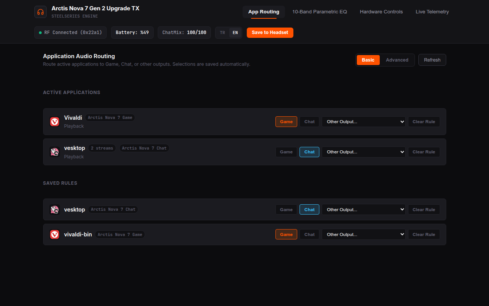
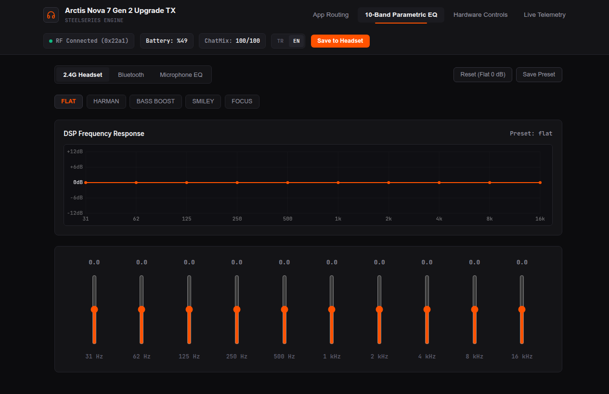
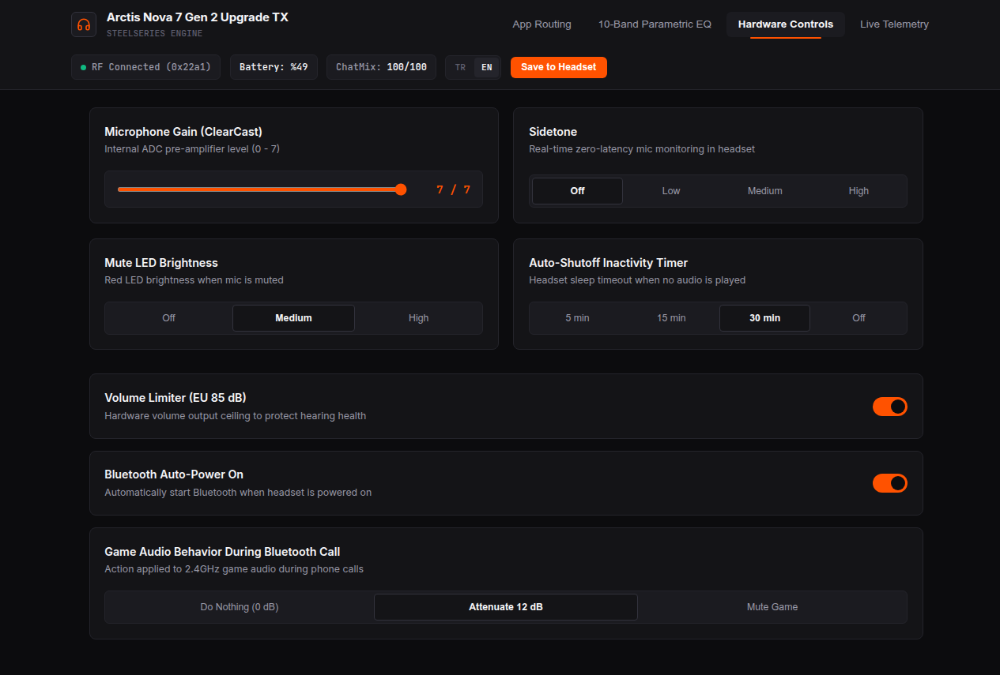

# Arctis Nova 7 ChatMix, 10-Band DSP EQ & Web Companion

Lightweight Linux daemon and hardware controller for the **SteelSeries Arctis Nova 7** headset family (`7`, `7P`, `7X`, `Gen 2`, `Diablo IV`, `WoW Edition`).

- **Real-Time PipeWire ChatMix**: Creates `Arctis_Game` & `Arctis_Chat` virtual sinks, maps the hardware ChatMix dial, and handles dongle hotplug/reconnects automatically.
- **Sonar-Style App Routing**: Route apps to `Game`, `Chat`, or any output from the Web UI with native app icons and persistent rules.
- **10-Band Hardware Parametric EQ & Controls**: Programs onboard DSP EQ profiles, Sidetone, ClearCast Mic Gain, EU Volume Limiter, Auto-Shutoff, Mute LED, and Bluetooth behavior, with onboard flash save.
- **Live Telemetry & Web Companion**: Embedded local dashboard at `http://127.0.0.1:3927` (TR / EN) with real-time battery, RF link, and ChatMix status.

---

## Quick Install (No Clone Required)

```bash
curl -fsSL https://raw.githubusercontent.com/m24ih/SteelSeries-Arctis-Nova-Linux/master/install.sh | bash
```

To update:

```bash
curl -fsSL https://raw.githubusercontent.com/m24ih/SteelSeries-Arctis-Nova-Linux/master/install.sh | bash -s -- --update
```

To uninstall:

```bash
curl -fsSL https://raw.githubusercontent.com/m24ih/SteelSeries-Arctis-Nova-Linux/master/install.sh | bash -s -- --uninstall
```

---

## Web Companion Screenshots

### App Audio Routing (Sonar-Style)


### 10-Band Parametric EQ


### Hardware Controls


---

## Install from Source

```bash
git clone https://github.com/m24ih/SteelSeries-Arctis-Nova-Linux.git
cd SteelSeries-Arctis-Nova-Linux
./install.sh
```

Options: `./install.sh --system` (system-wide service), `./install.sh --update` (latest release binary), `./install.sh --binary PATH`, `./install.sh --uninstall`.

Open the dashboard at **`http://127.0.0.1:3927`**.

---

## Notes & Support

- **Hardware Verification**: All 23 Arctis Nova 7 RX/TX USB Product IDs are implemented in code and `udev` rules; live hardware verification was performed on **Arctis Nova 7 Gen 2 (`0x22a1`)**. Community testing and feedback for other variants are very welcome!
- **Arch Linux (AUR)**: Packaging files are included under [`aur/`](aur/), however official AUR publication is currently unavailable because new AUR account registration is suspended.
- **Bug Reports & Compatibility**: Found an issue or tested another headset variant? **[Report a Bug or Hardware Compatibility Issue](https://github.com/m24ih/SteelSeries-Arctis-Nova-Linux/issues/new/choose)**.

---

## Documentation & Technical Reference

For supported USB Product IDs (all 23 RX/TX models), HID/PipeWire architecture, `config.toml` layout, CLI flags, manual `udev` setup, and troubleshooting, see:

- **[Technical Reference (`docs/TECHNICAL.md`)](docs/TECHNICAL.md)**

---

## License

This project is provided under the MIT license — see [LICENSE](LICENSE).
